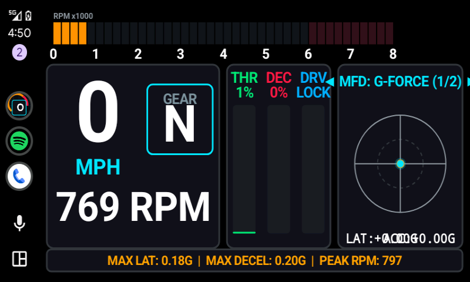
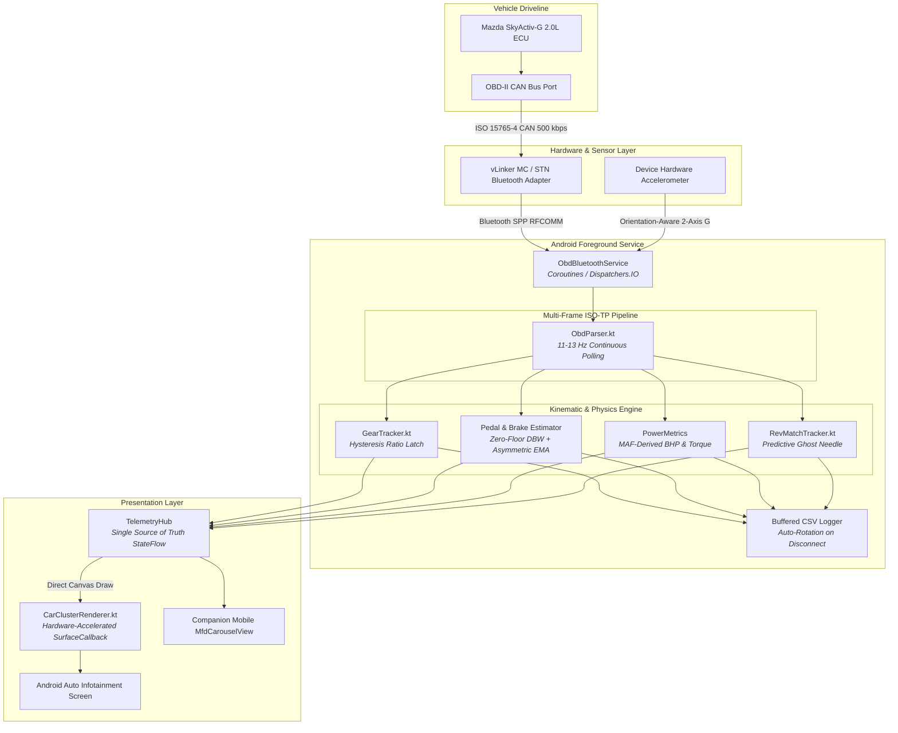

# MXTelemetry

**Custom Android Auto Performance Cluster & High-Frequency OBD-II Kinematic Telemetry Engine**  
*Calibrated and validated on the ND2 Mazda MX-5 platform (SkyActiv-G 2.0L 6MT).*

[-blue.svg)](#tech-stack--architecture)
[](#tech-stack--architecture)
[](#driveline-calibration-table-nd2-6mt)
[-brightgreen.svg)](#unit-testing--verification)
[](LICENSE)

---

## Visuals & User Interface

<p align="center">
  
  <br>
  <em>Android Auto Infotainment Cluster — S2000 Sweep Tachometer, Kinematic Gear Latch, 3-Channel Pedal Bars, and Multi-Function Display</em>
</p>

---

## Technical Overview

Modern OEM instrumentation frequently abstracts, filters, or delays critical powertrain telemetry. Standard mobile OBD-II solutions introduce sample jitter and windshield mount clutter unsuited for track use or spirited driving.

**MXTelemetry** bridges raw vehicle bus diagnostics and inertial sensors directly to the factory infotainment screen via an independent **Android Auto `NavigationTemplate` / `SurfaceRenderer`** pipeline. Validated across **250,906 contiguous frames (>6 hours of physical road testing)** with zero socket drops, it provides an S2000-style horizontal sweep tachometer, multi-frame ISO-TP CAN parsing, kinematic transmission gear tracking, drive-by-wire pedal calibration, live powertrain dyno gauges, and downshift rev-match assist.

---

## System Architecture & Data Pipeline

MXTelemetry decouples diagnostic polling, hardware IMU tracking, kinematic state estimation, and UI rendering across isolated coroutine dispatchers inside an Android Foreground Service:



---

## Core Engineering Features

### 1. Dynamic Kinematic Gear Determination (`GearTracker.kt`)
Because production manual transmissions lack electronic gear-selector switches, transmission state is solved kinematically by evaluating the effective driveline ratio:

$$R_{\text{effective}} = \frac{N_{\text{engine}}\text{ (RPM)}}{V_{\text{vehicle}}\text{ (MPH)}}$$

* **Hysteresis Latching:** Implements a multi-sample sliding window ($N=5$ samples) to reject driveline shock and clutch transition noise during shifting ($\sigma = 0.16$ in 6th gear).
* **Idle Exclusion Band:** Suppresses false neutral/first-gear determinations near idle ($N_{\text{engine}} < 755\text{ RPM}$) or near zero ground speed ($V_{\text{vehicle}} \approx 0\text{ MPH}$).
* **Lock State Evaluation:** Differentiates between locked clutch engagement (`DRV LOCK`) and free-wheeling neutral coast-down (`FREE`).

### 2. Drive-by-Wire Pedal Calibration & Inertial Brake Estimation (`Telemetry.kt`)
* **Zero-Floor Throttle Calibration:** Electronic throttle control (ETC) keeps the physical throttle plate (`PID 0x11`) at $10\%\text{--}14\%$ at idle for airflow management. MXTelemetry maps physical rest ($12.0\%$) to $0.0\%$ operator pedal intent (`THR`), eliminating ghost throttle inputs.
* **Asymmetric EMA Braking & Standstill Hold:** Synthesizes longitudinal deceleration ($G_{\text{long}}$) into a $0\text{--}100\%$ braking proxy (`DEC`) smoothed via an asymmetric low-pass filter ($\alpha_{\text{attack}} = 0.35$, $\alpha_{\text{decay}} = 0.20$), with a $25\%$ standstill hold at stoplights until throttle tip-in.

### 3. Live Powertrain Dyno Estimator (`PowerMetrics`)
* Derives instantaneous crank horsepower and torque from real-time Mass Airflow (`PID 0x10`) and engine speed without external chassis dyno sensors:

$$\text{BHP} \approx \frac{\text{MAF (g/s)}}{0.80}, \qquad \text{Torque (lb-ft)} = \frac{\text{BHP} \times 5252}{\text{RPM}}$$

* Rendered on Page 2 of the MFD carousel as dual vertical bar gauges (`PWR` / `TRQ`) with session peak-hold pips and overrun fuel-cut zeroing.

### 4. Predictive Downshift Target Calculation (`RevMatchTracker.kt`)
* Senses brake onset and vehicle deceleration to compute the required engine speed for an immediate downshift to the next lower gear:

$$N_{\text{target}} = V_{\text{vehicle}} \times R_{\text{lower\_gear}}$$

* Drives a transient cue along the horizontal tachometer sweep to guide heel-and-toe throttle blips prior to clutch release.

### 5. Custom Low-Latency Canvas Renderer (`CarClusterRenderer.kt`)
* Hardware-accelerated `SurfaceCallback` canvas styled in Mazda Soul Red Crystal (`#D31120`), Sport Amber (`#FFB300`), and Pitch Black (`#0C0D0E`).
* Features a 0–8,000 RPM S2000-inspired segmented sweep, 3-channel pedal bars (`THR` / `DEC` / `DRV`), and a 3-page MFD carousel (**G-Force Vector**, **Thermals**, and **Powertrain Dyno**) mirrored identically on the mobile companion app (`MfdCarouselView.kt`).

---

## Driveline Calibration Table (ND2 6MT)

| Gear | Internal Ratio | Driveline Ratio ($R_{\text{total}} = R_{\text{gear}} \times R_{\text{final}}$) | Calibrated Kinematic Band (RPM/MPH) |
| :--- | :---: | :---: | :---: |
| **1st** | $5.087 : 1$ | $14.244 : 1$ | ~200 – 215 |
| **2nd** | $2.991 : 1$ | $8.375 : 1$ | ~118 – 128 |
| **3rd** | $2.035 : 1$ | $5.698 : 1$ | ~80 – 88 |
| **4th** | $1.594 : 1$ | $4.463 : 1$ | ~62 – 68 |
| **5th** | $1.286 : 1$ | $3.601 : 1$ | ~50 – 55 |
| **6th** | $1.000 : 1$ | $2.800 : 1$ | ~39 – 43 |

*Final Drive Ratio: $2.800 : 1$ (OEM Limited-Slip Differential, 205/45R17 tire diameter).*

---

## Vehicle & Hardware Compatibility

* **Validated Vehicle:** 2019+ Mazda MX-5 Miata (ND2, 2.0L SkyActiv-G, 6-Speed Manual).
* **Recommended Adapters:** vLinker MC/FD+ Bluetooth, OBDLink LX/MX+ (STN chipset recommended for sustained multi-frame ISO-TP polling).
* **Target OS:** Android 12 through Android 15 (API 31–35) utilizing non-location Bluetooth permission model (`neverForLocation`).

---

## Installation & Sideloading Guide

Because Android Auto restricts non-Play Store applications by default, install the APK using one of the following methods:

### Method A: Android Auto Developer Mode (Recommended)
1. On your Android device, navigate to **Settings → Connected devices → Android Auto**.
2. Scroll to the bottom and tap **Version** 10 times consecutively to enable Developer Mode.
3. Tap the top-right menu icon (**⋮**) → **Developer settings**.
4. Check **Unknown sources** and set **Application Mode** to **Developer** or **Release**.
5. Build and install via ADB:
   ```bash
   ./gradlew assembleDebug
   adb install -r app/build/outputs/apk/debug/app-debug.apk
   ```

### Method B: Package Installer Spoofing (KingInstaller + Shizuku)
1. Enable **Shizuku** via Wireless Debugging or ADB.
2. Open **KingInstaller**, grant Shizuku privileges, and enable **Install as Play Store**.
3. Select `app-debug.apk` and execute the installation.

---

## Unit Testing & Verification

Kinematic state machines, power estimators, and parsing logic are validated against **250,906 recorded vehicle telemetry frames** (`obd_*.csv`):

```bash
./gradlew app:testDebugUnitTest
```

* `testKinematicGearDetection_lockedUpshifts()`: Verifies sequential ratio convergence across high-RPM shifts.
* `testDownshiftRevMatch_ghostNeedleTrigger()`: Validates mathematical convergence of blip targets during braking.
* `testAntiStallThreshold_suppression()`: Verifies idle exclusion logic suppresses stall flags above 680 RPM.
* `testPowerTorqueEstimation()`: Validates MAF-derived BHP and torque against empirical WOT pull vectors.
* `testTachSweepBoundaryBounds()`: Confirms LED sweep geometry clamps within canvas boundaries across varied head-unit aspect ratios.

---

## Tech Stack & Architecture

* **Primary Language:** Kotlin 100%
* **Car Interface:** Android Car App Library (`androidx.car.app:app:1.4.0`)
* **Concurrency & Lifecycle:** Android Foreground Service, Kotlin Coroutines, `StateFlow`
* **Protocol Handler:** Bluetooth SPP (Serial Port Profile) RFCOMM engine with multi-frame ISO-TP CAN reconstruction
* **Build System:** Gradle Kotlin DSL (`build.gradle.kts`)

---

## License

This project is licensed under the MIT License - see the [LICENSE](LICENSE) file for details.
