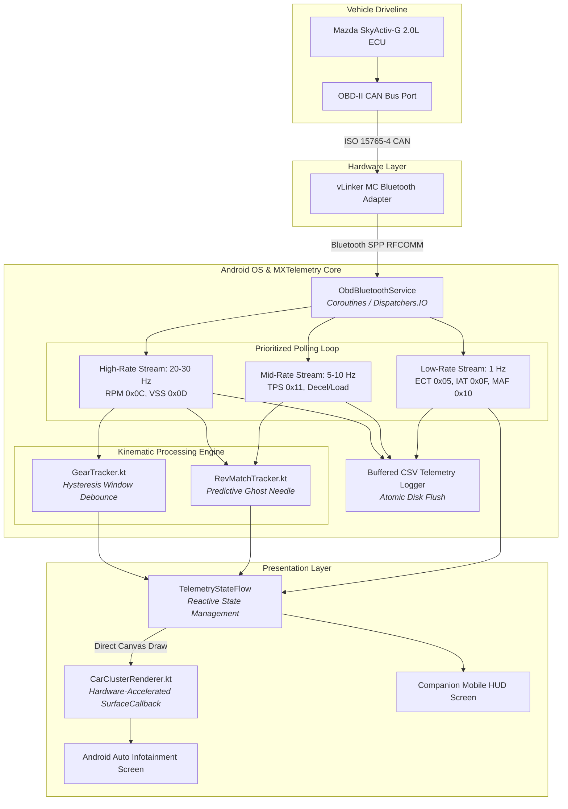

Here is the complete, production-ready `README.md` with clean GitHub-compatible KaTeX math, native Mermaid diagrams, architecture flow, calibration specs, and sideloading steps:

```markdown
# MXTelemetry

**Custom Android Auto Performance Cluster & High-Frequency OBD-II Kinematic Telemetry Engine**  
*Calibrated and validated on the ND2 Mazda MX-5 platform (SkyActiv-G 2.0L 6MT).*

[-blue.svg)](#tech-stack--architecture)
[](#tech-stack--architecture)
[](#driveline-calibration-table-nd2-6mt)
[](LICENSE)

---

## Visuals & User Interface

| Android Auto Infotainment Display | Mobile Companion & Diagnostics Utility |
| :---: | :---: |
| <br>*(S2000 Sweep Tach, Kinematic Gear, Dual G-Vector, Dynamic Thermals)* | <br>*(Low-Latency Connection Manager, Calibration Tare, CSV Logging)* |

---

## Technical Overview

Modern OEM instrumentation frequently abstracts, filters, or delays critical powertrain telemetry. Standard mobile OBD-II solutions (e.g., Torque Pro) introduce significant latency, sample jitter, and windshield mount clutter unsuited for track use or spirited driving.

**MXTelemetry** bridges raw vehicle bus diagnostics directly to the factory infotainment screen via an independent **Android Auto `NavigationTemplate` / `SurfaceRenderer`** pipeline. It provides a driver-centric digital cluster featuring an S2000-style horizontal sweep tachometer, tiered PID scheduling, real-time kinematic transmission gear tracking, downshift rev-match assist, and high-frequency CSV logging.

---

## System Architecture & Data Pipeline

MXTelemetry separates diagnostic polling, kinematic state tracking, and UI rendering across isolated coroutine dispatchers:



---

## Core Engineering Features

### 1. Dynamic Kinematic Gear Determination (`GearTracker.kt`)

Because production manual transmissions lack electronic gear-selector switches, transmission state is solved kinematically by evaluating the effective driveline ratio:

$$R_{\text{effective}} = \frac{N_{\text{engine}}\ (\text{RPM})}{V_{\text{vehicle}}\ (\text{MPH})}$$

* **Hysteresis Latching:** Implements a multi-sample FIFO sliding window ($N = 5$ samples) to reject driveline shock and clutch transition noise during shifting.
* **Idle Exclusion Band:** Suppresses false neutral/first-gear determinations when engine speed is near idle ($N_{\text{engine}} < 755\ \text{RPM}$) or vehicle ground speed is near zero ($V_{\text{vehicle}} \approx 0\ \text{MPH}$).
* **Lock State Evaluation:** Evaluates driveline compliance to differentiate between locked clutch engagement (`DRV LOCK`) and free-wheeling neutral coast-down (`FREE (est.)`).

### 2. Predictive Downshift Target Calculation (`RevMatchTracker.kt`)

* Senses brake onset and vehicle deceleration to compute the required engine speed for an immediate downshift to the next lower gear:

$$N_{\text{target}} = V_{\text{vehicle}} \times R_{\text{lower\_gear}}$$


* Drives a transient LED indicator along the horizontal tachometer sweep, giving the driver an immediate heel-and-toe rev-match target prior to clutch release.

### 3. Tiered Diagnostic Polling Pipeline (`ObdParser.kt`)

Standard ELM327 and STN interfaces saturate their serial buffers when polling diagnostic parameters uniformly. MXTelemetry uses an asynchronous prioritization scheduler:

* **High-Rate Stream (~20–30 Hz):** Polling Engine RPM (`0x0C`) and Vehicle Speed (`0x0D`) for minimum cluster visual lag.
* **Mid-Rate Stream (~5–10 Hz):** Polling Throttle Position (`0x11`) for load changes and rev-match triggers.
* **Low-Rate Background Stream (1 Hz):** Polling Engine Coolant Temp (`0x05`), Intake Air Temp (`0x0F`), and Mass Air Flow (`0x10`).

### 4. Custom Low-Latency Canvas Renderer (`CarClusterRenderer.kt`)

* Directly interfaces with the Android Auto `SurfaceCallback` canvas using hardware acceleration.
* 0–8000 RPM S2000-inspired segmented LED sweep with progressive amber transitions and a 7000–7500 RPM safety margin redline band.
* Live 2-axis accelerometer/G-force vectors with peak-hold memory and multi-unit thermal telemetry ($^\circ\text{F} / ^\circ\text{C}$).

---

## Driveline Calibration Table (ND2 6MT)

| Gear | Internal Ratio | Driveline Ratio ($R_{\text{total}} = R_{\text{gear}} \times R_{\text{final}}$) | Calibrated Kinematic Band (RPM/MPH) |
| --- | --- | --- | --- |
| **1st** | 5.087 : 1 | 14.244 : 1 | ~200 – 215 |
| **2nd** | 2.991 : 1 | 8.375 : 1 | ~118 – 128 |
| **3rd** | 2.035 : 1 | 5.698 : 1 | ~80 – 88 |
| **4th** | 1.594 : 1 | 4.463 : 1 | ~62 – 68 |
| **5th** | 1.286 : 1 | 3.601 : 1 | ~50 – 55 |
| **6th** | 1.000 : 1 | 2.800 : 1 | ~39 – 43 |

*Final Drive Ratio: 2.800 : 1 (OEM Limited-Slip Differential, 205/45R17 tire diameter).*

---

## Vehicle & Hardware Compatibility

* **Validated Vehicle:** 2019+ Mazda MX-5 Miata (ND2, 2.0L SkyActiv-G, 6-Speed Manual).
* **Recommended Adapters:** vLinker MC/FD+ Bluetooth, OBDLink LX/MX+ (STN chipset recommended for stable 30 Hz polling).
* **Target OS:** Android 12 through Android 15 (API 31–35) utilizing non-location Bluetooth permission model (`neverForLocation`).

---

## Installation & Sideloading Guide

Because Android Auto restricts non-Play Store applications by default, install the APK using one of the following methods:

### Method A: Android Auto Developer Mode (Recommended)

1. On your Android device, navigate to **Settings** $\rightarrow$ **Connected devices** $\rightarrow$ **Android Auto**.
2. Scroll to the bottom and tap **Version** 10 times consecutively to enable Developer Mode.
3. Tap the top-right menu icon ($\vdots$) $\rightarrow$ **Developer settings**.
4. Check **Unknown sources** and set **Application Mode** to **Developer** or **Release**.
5. Build and install via ADB:
```bash
./gradlew assembleDebug
adb install -r app/build/outputs/apk/debug/app-debug.apk

```


### Method B: Package Installer Spoofing (KingInstaller + Shizuku)

1. Enable **Shizuku** via Wireless Debugging or ADB.
2. Open **KingInstaller**, grant Shizuku privileges, and enable **Install as Play Store**.
3. Select `app-debug.apk` and execute the installation.

---

## Unit Testing & Verification

Kinematic state machines and parsing logic are validated against recorded vehicle telemetry traces (`obd_*.csv`):

```bash
./gradlew testDebugUnitTest

```

* `testKinematicGearDetection_lockedUpshifts()`: Verifies sequential ratio convergence across 7200 RPM redline shifts.
* `testDownshiftRevMatch_ghostNeedleTrigger()`: Validates mathematical convergence of blip targets during rapid braking.
* `testAntiStallThreshold_suppression()`: Verifies idle exclusion logic suppresses stall flags above 680 RPM.
* `testTachSweepBoundaryBounds()`: Confirms LED sweep geometry clamps within canvas boundaries across varied head-unit aspect ratios.

---

## Tech Stack & Architecture

* **Primary Language:** Kotlin 100%
* **Car Interface:** Android Car App Library (`androidx.car.app:app:1.4.0`)
* **Concurrency:** Kotlin Coroutines, `StateFlow`, `SharedFlow`
* **Protocol Handler:** Bluetooth SPP (Serial Port Profile) RFCOMM engine with multi-frame CAN support
* **Build System:** Gradle Kotlin DSL (`build.gradle.kts`)

---

## License

This project is licensed under the MIT License - see the [LICENSE](https://www.google.com/search?q=LICENSE) file for details.

```

```
